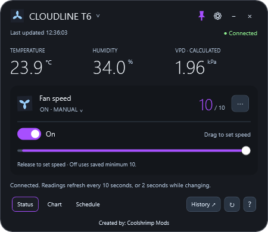
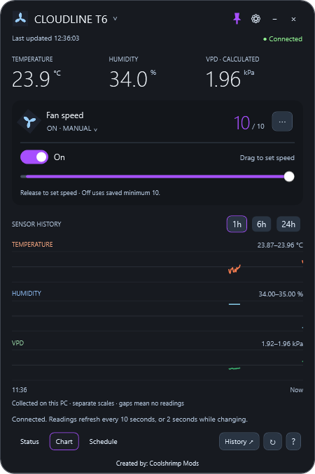
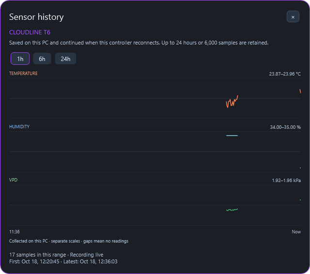
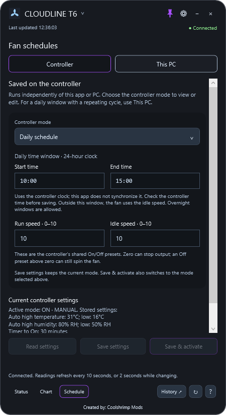
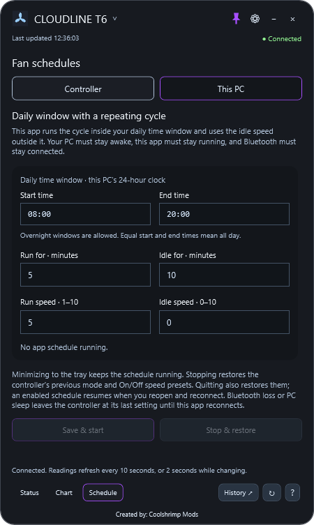
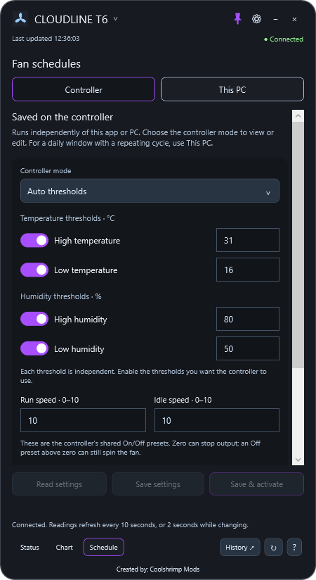

# AC Infinity Desktop

A compact Windows Bluetooth widget for **AC Infinity Controller 67 (CTR67A)**, made by [Coolshrimp Modz](https://coolshrimpmodz.com/).

Keep fan controls, temperature, humidity, and calculated VPD on your desktop. Connect several Bluetooth controllers at once, each in its own widget with independent controls, schedules, and sensor history.

Unofficial software; not affiliated with or endorsed by AC Infinity.

## Supported controller

**AC Infinity Controller 67 (CTR67A)** — Bluetooth fan control and sensor readings.


Controller 67 is currently the only identified controller model supported for control.

## Screenshots

All seven app views were captured while connected to a live Controller 67. Device addresses and private diagnostics are excluded.

| Status | Chart |
| --- | --- |
|  |  |

| Sensor history | Appearance |
| --- | --- |
|  |  |

The Controller examples show settings read from the connected controller. This PC shows saved editor values or defaults; no PC schedule was started for the capture.

| Controller schedule | This PC schedule |
| --- | --- |
|  |  |



## Get started

1. Open the [Releases page](https://github.com/coolshrimp/AC-Infinity-Fan-Controller/releases) and download the Windows x64 release asset.
2. Run the downloaded application. The .NET runtime is bundled; no separate runtime installation is required.
3. Keep the powered controller nearby and close other apps holding its Bluetooth connection.
4. The widget scans and connects automatically when exactly one compatible controller is available. Click the device name or connection badge to choose a controller manually.

Requires Windows 10 version 2004 or newer, or Windows 11, x64, and a working Bluetooth adapter. The application is unsigned. Native runtime components extract automatically on first launch.

## Multiple controllers

In the Bluetooth panel, select **Add another controller...** to open another widget. Each widget owns its connection, fan slider, On/Off toggle, readings, chart, appearance, and tray icon. Controllers already assigned to a widget are excluded from other widgets' discovery. Opening the application again restores existing widgets instead of making duplicate connections.

Additional controllers with automatic connection enabled are remembered. On relaunch, the main widget appears first; additional widgets stay hidden while retrying and appear only after a verified connection. Offline controllers do not create empty duplicate windows. Closing one widget releases only that controller; the other widgets keep running. Give each controller a friendly name in Bluetooth settings to tell them apart.

The two fan sockets on a Controller 67 **share its programming**. Separate widgets represent separate Bluetooth controllers, not individual fans attached to one Controller 67. Temperature and humidity come from each controller's reported sensor data; extra sensor channels are not invented.

## Controls and views

- **Status:** the default tab on launch, with temperature, humidity, calculated VPD, controller mode, and fan controls.
- **Chart:** a compact history overview with 1h, 6h, and 24h ranges. **History ↗** opens a separate, larger panel with temperature, humidity, VPD, sample counts, and first/latest timestamps. Saved readings can be reviewed while disconnected.
- **Schedule:** the controller program editor and **This PC** scheduler are embedded in the widget. The **⋯** fan options button and the dropdown on the current mode label select Manual Off, Manual On, Auto, Timer to On, Timer to Off, Repeating cycle, or Daily schedule.
- Release the speed slider at **1–10** to select manual On mode at that level. **0** selects the saved Off mode. The colored fill shows reported output while you choose a target.
- The **On/Off** toggle selects stored presets. Off can still spin the fan when its saved minimum is above zero.
- **Pin** keeps a widget and its panels on top. **Settings** changes colors, opacity, and temperature units. **Minus** hides that widget to its tray icon; **Close** quits that widget.

Live readings normally refresh every 10 seconds, switching to two-second reads while output changes. Requests are serialized per controller. Reconnecting reads settings and status. An enabled PC schedule then applies its current phase; a stopped schedule with pending restoration restores its previous controller mode and presets. Disconnect stops the PC schedule and restores its previous settings before releasing Bluetooth, then pauses automatic retries until a manual reconnect, scan, or restart.

## Fan schedules and controller programs

Open the **Schedule** tab or **Fan schedules…** from that widget's tray menu. Each controller has its own program editor, PC schedule, and recovery settings. Opening the editor and switching its sections preserves your entries; regular reading updates do not replace edits.

### Controller

These programs are saved on the controller and run without this app or PC. Choose from all seven basic modes: **Manual Off**, **Manual On**, **Auto thresholds**, **Timer to On**, **Timer to Off**, **Repeating cycle**, and **Daily schedule**. The controller's shared run/On and idle/Off presets both accept **0–10**. Zero can stop output; an Off preset above zero can keep the fan spinning.

**Read settings** loads the controller's saved values. **Save settings** immediately writes the displayed program settings and On/Off presets, then reselects the previous mode if the firmware switched modes during the write. Some firmware can briefly activate the edited mode while saving. **Save & activate** selects the edited mode after saving. Both actions check the saved settings through fresh readback. Saving a program or its presets can affect fan output immediately.

Auto has four independent enabled/disabled triggers: high temperature, low temperature, high humidity, and low humidity. Temperature thresholds use whole degrees in the selected **°C** or **°F** unit; humidity uses whole percentages. Each trigger is independent, so the editor does not require low thresholds to be below high thresholds. Unedited temperature pairs and other stored flags remain intact when saving.

Timer and repeating-cycle durations use **HH:mm:ss**, from **00:00:01** through **24:00:00**. Each run and idle duration is independent. Before editing the timer that is currently counting down, select **Manual On** or **Manual Off**; the app blocks that active timer edit to avoid resetting it during the countdown. Daily schedules use **HH:mm** and the **controller's own clock**; check that clock before saving because this app does not synchronize it. Start and end must differ, and overnight windows are allowed.

For a daily window combined with a repeating cycle, use **This PC** below. This version does not configure additional onboard advanced automation slots.

### This PC

Set a daily window and a repeating run/idle cycle, then choose **Save & start**. Starting immediately applies the current phase and its run/idle presets, including idle outside the window. Run speed is **1–10**, idle speed is **0–10**, and each cycle duration is **1–1,440 whole minutes**. The app cycles inside the window and uses the idle speed outside it.

Overnight windows are allowed. Equal start and end times select all day; the cycle starts again at the daily start time. This schedule follows this PC's local clock.

Keep the PC awake, this app running, and Bluetooth connected. Minimizing to the tray keeps it running. The widget shows the current schedule state, and the tray menu offers **Stop PC schedule**.

**Stop & restore** returns the controller to the mode and On/Off presets it had before this PC schedule started. Using the app's manual controls first stops the PC schedule and restores those settings, then applies your change. Saving a controller program also stops the PC schedule before writing that program.

Quitting normally restores the previous controller mode and presets while keeping the PC schedule enabled in local settings for the next launch. After reopening and reconnecting to the same controller, the app applies the current phase without replaying missed changes. If Bluetooth drops or the app closes unexpectedly, the controller may keep the last applied mode and speed until reconnection. A stopped schedule that could not restore its settings keeps that restoration pending for the same controller.

## Privacy and local data

No account, cloud service, or telemetry is used. Preferences and Bluetooth addresses remain under `%LOCALAPPDATA%\ACInfinityDesktop`. Each widget saves its PC schedule, controller association, and previous controller mode/presets locally with its preferences. Additional widget settings live in its `controllers` subfolder. Sensor history is stored in the shared `history` subfolder, separately for each controller address.

History is collected only while this PC is connected. It retains up to 24 hours or 6,000 samples per controller, and is saved about once per minute and on exit. It does not download earlier readings from the controller or cloud. Gaps longer than 60 seconds are not joined on charts. Disconnected widgets retain history while clearing live values.

## Build and verify

Install the .NET 10 SDK, then run:

```powershell
dotnet build ACInfinityDesktop.csproj -c Release
./publish.ps1
./verify.ps1
```

The publish profile creates one self-contained Windows x64 application under `Releases/dotnet-<version>`. WPF trimming is disabled. Generated binaries, private settings, and diagnostics are ignored by Git.

`verify.ps1` runs offline protocol/settings/schedule/controller-editor checks and window smoke checks, including all controller editor layouts, multiple-widget isolation, hidden offline restoration, independent window shutdown, and the separate history panel. Smoke checks use in-memory settings and never connect to Bluetooth. Diagnostic results remain under the ignored `diagnostics/verification` directory.

The GitHub workflow builds and verifies pull requests and pushes to `main` or `master`. Pushing a version tag matching the project version, such as `v0.8.0`, runs the same checks and publishes a release containing one Windows executable. The workflow has read-only permissions during builds; release publishing receives repository-content write permission in a separate job. No personal access token is stored in the repository.

For maintainers, `--capture-live --output screenshots` exports seven documentation views into the screenshots folder from a real connection, waits for a fresh sample, and exits. Capture mode blocks fan writes and leaves saved preferences and history unchanged. Close other copies before capturing.

For UI development, open `ACInfinityDesktop.code-workspace` in VS Code or the solution in Visual Studio. Each window and the embedded `ProgramsView` editor have separate XAML and code-behind; shared styles live in `Theme.xaml`.

## Compatibility and testing limits

Control is restricted to verified Controller 67-compatible Bluetooth replies. Unsupported advertised models cannot receive commands. A compatible protocol without a known model advertisement does not confirm the exact controller model. Friendly fan names are user labels, not detected fan hardware.

VPD is calculated from air temperature and humidity without a leaf-temperature offset. Wi-Fi cloud controllers and independent fan-port control are outside the supported scope.

Live checks on one Controller 67 verified unchanged Auto settings, a changed high-temperature pair with unrelated bytes preserved, an independent high-temperature enable toggle, and Auto mode selection. Timer-to-On and Timer-to-Off settings retained exactly 61 and 67 seconds respectively before activating their modes. Cycle and daily programs were saved and selected. PC-managed phases reached reported outputs 10 and 0, and stopping restored the captured mode and presets. The complete original stored program settings and mode were restored and confirmed after reconnect.

These checks cover configuration writes, readback, mode selection, and reported output; reported output is not a motor RPM measurement. Full-duration native timing, Auto response to changing sensor thresholds, simultaneous physical controllers, and real radio-dropout recovery still require hardware testing. Multiple-widget lifecycle and isolation have offline coverage.

When reporting an issue, include your Windows version, controller model, and reproduction steps. Redact Bluetooth addresses and other private diagnostic details.

## Support the project

If this tool helped you out or you enjoy having fan control on your desktop, donations are appreciated. [Support Coolshrimp Modz](https://links.coolshrimpmodz.com/).

## Source and license

The application is native C# / WPF. `Native/BluetoothController.cs` handles BLE/GATT, and `Native/Protocol.cs` validates controller packets. `Native/SensorHistory.cs` maintains bounded local history; `Native/FanSchedule.cs` evaluates PC schedule phases.

Copyright 2026 Coolshrimp Modz. All rights reserved for the application code; see [LICENSE](LICENSE). Upstream protocol notices and their separate license terms are retained in [vendor/THIRD_PARTY_NOTICES.md](vendor/THIRD_PARTY_NOTICES.md) and [vendor/Viss-LICENSE.txt](vendor/Viss-LICENSE.txt).
