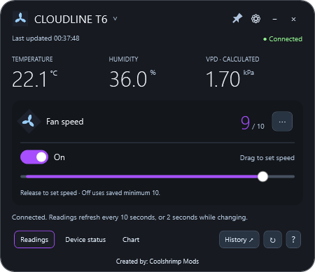
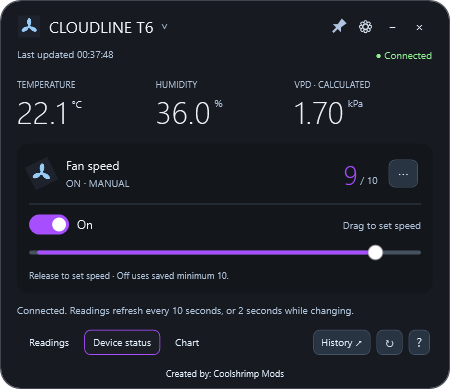
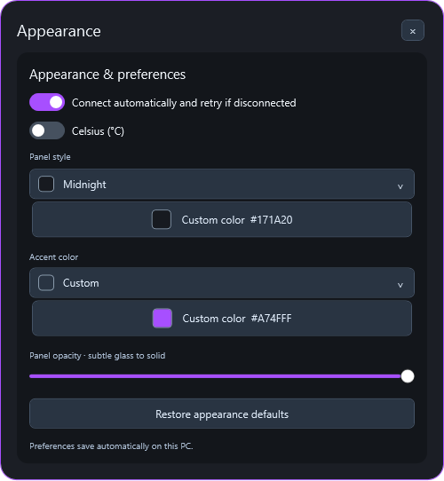

# AC Infinity Desktop

A compact Windows Bluetooth widget for **AC Infinity Controller 67 (CTR67A)**, made by [Coolshrimp Modz](https://coolshrimpmodz.com/).

Keep fan controls, temperature, humidity, and calculated VPD on your desktop. Connect several Bluetooth controllers at once, each in its own widget with independent controls and sensor history.

Unofficial software; not affiliated with or endorsed by AC Infinity.

## Screenshots

Captured from a live Controller 67 connection. Device addresses and private diagnostics are excluded.

| Readings | Device status |
| --- | --- |
|  |  |

| Sensor history | Appearance |
| --- | --- |
|  |  |

## Get started

1. Open this repository's **Releases** page and download the Windows x64 release asset.
2. Run the downloaded application. The .NET runtime is bundled; no separate runtime installation is required.
3. Keep the powered controller nearby and close other apps holding its Bluetooth connection.
4. The widget scans and connects automatically when exactly one compatible controller is available. Click the device name or connection badge to choose a controller manually.

Requires Windows 10 version 2004 or newer, or Windows 11, x64, and a working Bluetooth adapter. The application is unsigned. Native runtime components extract automatically on first launch.

## Multiple controllers

In the Bluetooth panel, select **Add another controller...** to open another widget. Each widget owns its connection, fan slider, On/Off toggle, readings, chart, appearance, and tray icon. Controllers already assigned to a widget are excluded from other widgets' discovery. Opening the application again restores existing widgets instead of making duplicate connections.

Additional controllers with automatic connection enabled are remembered. On relaunch, the main widget appears first; additional widgets stay hidden while retrying and appear only after a verified connection. Offline controllers do not create empty duplicate windows. Closing one widget releases only that controller; the other widgets keep running. Give each controller a friendly name in Bluetooth settings to tell them apart.

The two fan sockets on a Controller 67 **share its programming**. Separate widgets represent separate Bluetooth controllers, not individual fans attached to one Controller 67. Temperature and humidity come from each controller's reported sensor data; extra sensor channels are not invented.

## Controls and views

- **Readings:** temperature, humidity, calculated VPD, and fan controls.
- **Device status:** readings plus the active controller mode and stored-program viewer.
- **Chart:** a compact history overview with 1h, 6h, and 24h ranges. **History ↗** opens a separate, larger panel with temperature, humidity, VPD, sample counts, and first/latest timestamps. Saved readings can be reviewed while disconnected.
- Release the speed slider at **1-10** to select manual On mode at that level. **0** selects the saved Off mode. The colored fill shows reported output while you choose a target.
- The **On/Off** toggle selects stored presets. Off can still spin the fan when its saved minimum is above zero.
- **Pin** keeps a widget and its panels on top. **Settings** changes colors, opacity, and temperature units. **Minus** hides that widget to its tray icon; **Close** quits that widget.
- Stored Auto thresholds, timers, cycles, and schedules can be viewed. Editing stored programs is not implemented.

Live readings normally refresh every 10 seconds, switching to two-second reads while output changes. Requests are serialized per controller. Reconnecting reads settings and status without changing the mode or speed. Disconnect pauses automatic retries for that widget until a manual reconnect, scan, or restart.

## Privacy and local data

No account, cloud service, or telemetry is used. Preferences and Bluetooth addresses remain under `%LOCALAPPDATA%\ACInfinityDesktop`. Additional widget settings live in its `controllers` subfolder. Sensor history is stored in the shared `history` subfolder, separately for each controller address.

History is collected only while this PC is connected. It retains up to 24 hours or 6,000 samples per controller, and is saved about once per minute and on exit. It does not download earlier readings from the controller or cloud. Gaps longer than 60 seconds are not joined on charts. Disconnected widgets retain history while clearing live values.

## Build and verify

Install the .NET 10 SDK, then run:

```powershell
dotnet build ACInfinityDesktop.csproj -c Release
./publish.ps1
./verify.ps1
```

The publish profile creates one self-contained Windows x64 application under `Releases/dotnet-<version>`. WPF trimming is disabled. Generated binaries, private settings, and diagnostics are ignored by Git.

`verify.ps1` runs offline protocol/settings checks and eight window checks, including multiple-widget isolation, hidden offline restoration, independent window shutdown, and the separate history panel. Smoke checks use in-memory settings and never connect to Bluetooth. Diagnostic results remain under the ignored `diagnostics/verification` directory.

The GitHub workflow builds and verifies pull requests and pushes to `main` or `master`. Pushing a version tag matching the project version, such as `v0.6.5`, runs the same checks and publishes a release containing one Windows executable. The workflow has read-only permissions during builds; release publishing receives repository-content write permission in a separate job. No personal access token is stored in the repository.

For maintainers, `--capture-live --output <directory>` exports the four documentation views from a real connection, waits for a fresh sample, and exits. Capture mode blocks fan writes and leaves saved preferences and history unchanged. Close other copies before capturing.

For UI development, open `ACInfinityDesktop.code-workspace` in VS Code or the solution in Visual Studio. Each window has separate XAML and code-behind; shared styles live in `Theme.xaml`.

## Compatibility and testing limits

Control is restricted to verified Controller 67-compatible Bluetooth replies. Unsupported advertised models cannot receive commands. A compatible protocol without a known model advertisement does not confirm the exact controller model. Friendly fan names are user labels, not detected fan hardware.

VPD is calculated from air temperature and humidity without a leaf-temperature offset. Wi-Fi cloud controllers and independent fan-port control are outside the supported scope.

Live readings have been checked on one physical Controller 67. Multiple-widget lifecycle and isolation have offline coverage; simultaneous connections to several physical controllers still require hardware testing. Motor response to speed/mode writes and real radio dropout recovery have not been deliberately verified in this review.

When reporting an issue, include your Windows version, controller model, and reproduction steps. Redact Bluetooth addresses and other private diagnostic details.

## Support the project

If this tool helped you out or you enjoy having fan control on your desktop, donations are appreciated. [Support Coolshrimp Modz](https://links.coolshrimpmodz.com/).

## Source and license

The application is native C# / WPF. `Native/BluetoothController.cs` handles BLE/GATT, `Native/Protocol.cs` validates controller packets, and `Native/SensorHistory.cs` maintains bounded local history.

Copyright 2026 Coolshrimp Modz. All rights reserved for the application code; see [LICENSE](LICENSE). Upstream protocol notices and their separate license terms are retained in [vendor/THIRD_PARTY_NOTICES.md](vendor/THIRD_PARTY_NOTICES.md) and [vendor/Viss-LICENSE.txt](vendor/Viss-LICENSE.txt).
